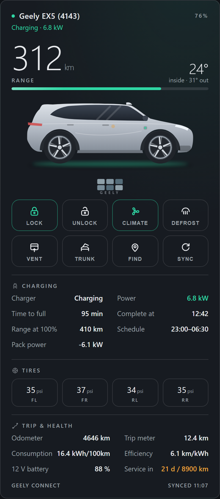
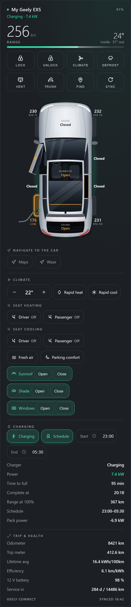
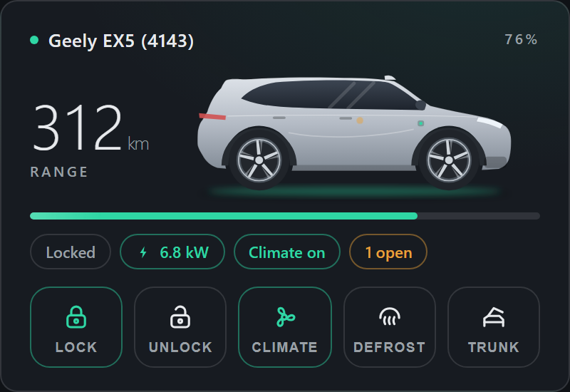
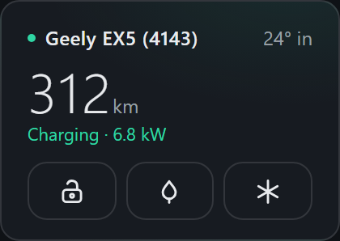
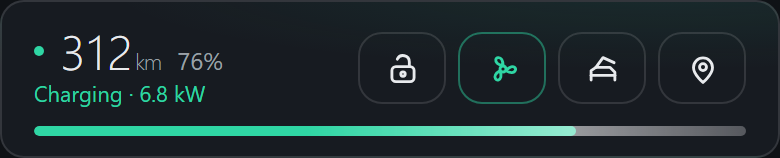
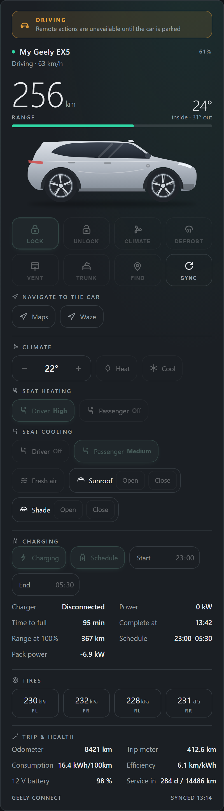
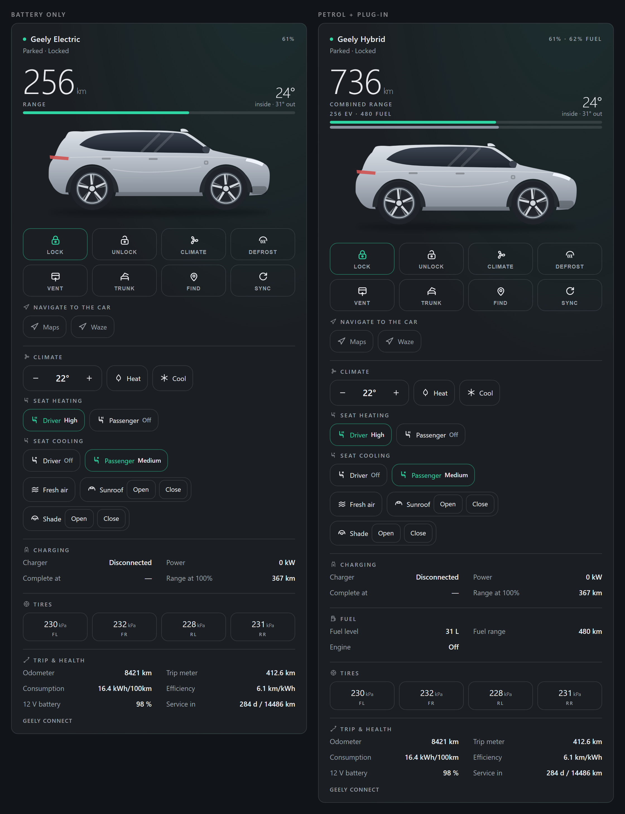

# Geely Connect

[](https://my.home-assistant.io/redirect/hacs_repository/?owner=YossiKon&repository=geely-connect&category=integration)
[](https://github.com/hacs/default)
[](LICENSE)

> ⚠️ **Unofficial, community-built integration.** Not affiliated with, endorsed
> by, or supported by Geely. Use at your own risk.

A **security-hardened** [Home Assistant](https://www.home-assistant.io/)
integration for Geely cars that use the **Geely Global / International** app.
It talks directly to Geely's own cloud, the same servers the official app uses,
and adds a hardened transport, full data exposure, efficient polling and a set
of dashboard cards on top.

**Tested by owners on** the **Geely EX5** (Europe, Australia and Brazil), the
**EX2** (Australia on the [new Geely EM
platform](#the-new-geely-em-zeekr-platform--a-different-experimental-model),
South Africa, where it is sold as the **E2**, and Colombia) and the **Starray
PHEV** (Australia). The integration is capability-driven, so other Geely models
should work too: only the entities your car reports are created, and a car with
a tank gets the fuel and engine ones on top.

> **What the app cannot do remotely, this cannot either.** Every command goes
> through the same cloud the official app talks to, so the app is the ceiling.
> The powered tailgate is the example: the car opens it from the key fob and its
> own screen, and neither the app nor this integration can
> ([#20](https://github.com/YossiKon/geely-connect/issues/20)).

---

## ✨ Highlights

- 🔒 **Security-first** - verified TLS plus public-key pinning, and secrets
  masked in logs and in the diagnostics report.
- 📊 **Everything enabled** - all 88 entities are on from the start (101 on a
  hybrid), no duplicates, nothing to switch on by hand.
- 🧮 **Computed extras** - charging power, charge completion time, range at full
  charge and efficiency, none of which the car reports itself.
- ⛽ **Hybrids and PHEVs** - fuel level and range, engine state, oil and coolant,
  the fuel flap, and the split of the odometer between petrol and battery, added
  automatically when the car has a tank.
- 🔋 **Efficient polling** - Super Eco, Eco, Normal, Live or Manual, changeable
  at any time.
- 🌍 **EU, North-American and APAC** backends, detected from the vehicle, plus
  the new Geely EM platform as an experimental option.
- 🖥️ **Five built-in dashboard cards**, registered automatically. The top view
  opens each door, window, the hood, the tailgate and the sunroof as the car
  reports them, and flags a low or flat tire.
- 🚗 **Cards that know the car** - they stand down while you drive, space
  commands out because the car drops one that arrives while it is busy, and link
  to the car in Google Maps, Waze, Apple Maps or HERE WeGo.
- 🗣️ **Translated** - setup in eight languages; the cards follow Home
  Assistant's language.
- 🩺 **A diagnostics report worth reading** - poll health, the last 25 commands
  with their outcomes, and the raw capability catalogue, all redacted.
- 📈 **Long-term statistics** on every numeric entity, so history survives the
  recorder's purge window.

---

## 📚 Contents

- [Installation](#-installation-hacs) · [Updating](#-updating)
- [Dashboard cards](#%EF%B8%8F-dashboards--cards)
- [Sensors](#-what-you-can-see-sensors) · [Controls](#%EF%B8%8F-what-you-can-do-controls)
- [Polling modes](#-efficient-adaptive-polling) · [Changing settings later](#%EF%B8%8F-changing-settings-later)
- [Automations, dashboards & widgets](#-automations-dashboards--widgets)
- [The Geely EM platform](#the-new-geely-em-zeekr-platform--a-different-experimental-model) · [Supported regions](#-supported-regions)
- [Security](#-security) · [Troubleshooting & debugging](#-troubleshooting--debugging)
- [Known limitations](#%EF%B8%8F-known-limitations) · [Repository structure](#-repository-structure) · [License & credits](#-license--credits)

---

## 📥 Installation (HACS)

Geely Connect is in the **HACS default store**, so there is no repository URL to
add.

**One click:** [](https://my.home-assistant.io/redirect/hacs_repository/?owner=YossiKon&repository=geely-connect&category=integration)

Or step by step:

1. HACS → search **Geely Connect** → open it → **Download**, then **restart Home
   Assistant**.
2. Settings → Devices & Services → **Add Integration** → **Geely Connect**.
3. Pick the platform (the existing Geely backend unless your account uses the
   new Geely EM app), enter your email, choose **country / tire-pressure unit /
   polling mode**, then enter the 6-digit code sent to your inbox. A **Geely EM**
   entry asks for your Geely account password instead of a code, and stores it
   unless you untick that option; to have it encrypted, add a
   `geely_password_key` to `secrets.yaml` before this step (see
   [its section](#the-new-geely-em-zeekr-platform--a-different-experimental-model)).

### The repository doesn't show up in HACS?

- Clear any active filters in the HACS search box, and make sure you are looking
  under **Integrations**.
- HACS caches its repository list. Force a refresh with ⋮ → **Reload data** on
  the HACS main page.
- Added it as a custom repository before? It still works. To tidy up, open HACS
  → ⋮ → **Custom repositories** → 🗑 next to this repository. Removing the
  *custom repository entry* does not uninstall the integration: the store copy
  takes over and updates continue normally.

### Manual installation

Copy `custom_components/geely_connect/` into `config/custom_components/` and
restart.

### 🛜 Setup times out? Check these hosts are reachable

Setup runs **from the Home Assistant machine**, not from your browser, so only
the network the Home Assistant box is on matters. On the existing platform it
must reach these hosts; a Geely EM entry talks to a different set.

| Host | Where | When |
|---|---|---|
| `captcha4.geely.com` | 🇨🇳 China (Alibaba, Hangzhou) | **Login only** - the captcha that runs before the email code |
| `access-app-global.geely.com` | 🇩🇪 Frankfurt | Login only - sends the email code, exchanges the OTP |
| `m-lcmsam-eu.geely.com` | 🇩🇪 Frankfurt | Login - the vehicle list. On a car on the EU backend (South African accounts included) also **ongoing**: every session renewal takes a one-time code from it |
| `api.ecloudeu.com` | 🇩🇪 Frankfurt (AWS) | Once at setup - provisions the certificate |
| `apis.ecloudeu.com` | 🇩🇪 Frankfurt (AWS) | **Ongoing** - every poll and every command |

An APAC-market car uses the Korean pair instead: `api.ecloudkr.com` and
`apis.ecloudkr.com` (AWS, Seoul/Incheon), plus `m-lcmsam-kr.geely.com`. Its
session renewals go to `m-lcmsam-kr.geely.com` and `api.ecloudkr.com`, so both
stay in use after setup. A North-American car, and a Brazilian account, which
resolves there, uses `api.ecloudus.com` and `apis.ecloudus.com`, and renews its
session through `m-lcmsam-us.geely.com`.

**Blocking China after setup is fine.** Only the captcha lives there, and only
the login touches it. Lift the block when you add a car, or if Home Assistant
asks you to re-authenticate. The captcha host resolves through
`*.geely-auto-gtm.com` to rotating Alibaba addresses, so a static IP allowlist
will not hold; scope a firewall rule to the Home Assistant machine instead.

If the form spins and then reports the captcha server as unreachable, the usual
culprits are DNS filtering (Pi-hole, AdGuard or router blocklists that include
Chinese domains) or firewall geo-blocking. Test from the Home Assistant box
itself:

```sh
curl -sv --connect-timeout 10 https://captcha4.geely.com/ -o /dev/null
# or, if curl is missing:
python3 -c "import socket;s=socket.create_connection(('captcha4.geely.com',443),10);print('TCP OK ->',s.getpeername());s.close()"
```

A healthy DNS answer chains through `geely-auto-gtm.com` to
`*.cn-shanghai.alb.aliyuncsslb.com`. If your resolver returns `0.0.0.0` or a
private address instead, allowlist `captcha4.geely.com`, `*.geely-auto-gtm.com`
and `*.aliyuncsslb.com` and try again.

---

## 🔄 Updating

**You never need to remove and re-add the integration.** Your vehicle, history,
automations and dashboards all survive an update.

1. HACS → **Geely Connect** → **Update**.
2. **Restart Home Assistant** - always required. *Reload* on the integration
   rebuilds the entities from the code already in memory and does not pick up a
   new version.

Turn on HACS → ⋮ → **Settings** → *Show notification when a new version is
available*, and updates also appear under Settings → **Updates**.

### No update showing?

HACS refreshes repository data on a timer. Force it with HACS → **Geely
Connect** → ⋮ → **Update information**, or ⋮ → **Reload data** on the HACS main
page. Updates arrive as tagged releases: a fix that has landed on `main` reaches
you with the next release.

---

## 🖥️ Dashboards & cards

This section covers the cards built into the integration. Full dashboards,
automations and blueprints are under [Automations, dashboards & widgets](#-automations-dashboards--widgets).

### 🚙 The built-in cards - zero setup

The integration ships **five cards** and registers them by itself - no HACS
frontend package, no resource to add, nothing to copy. Open any dashboard, **Add
card**, and search "Geely". A page that was already open when you set the
integration up needs one hard refresh first (Ctrl+F5, Cmd+Shift+R in Chrome or Firefox on a Mac, or
*Reset frontend cache* in the companion app), because it reads the dashboard
resources only when it loads
([#115](https://github.com/YossiKon/geely-connect/issues/115)).

| Card | What it is |
|---|---|
| **Geely Card** (`custom:geely-card`) | The full cockpit: range and battery up top, the car that glows while charging and flags every opening, one-tap Lock / Unlock / Climate / Defrost / Vent / Trunk / Find / Sync, a full climate panel, charging and schedule controls, links to the car in your map app, then charging, tires, trip and service health. Each block hides itself when the car doesn't report it |
| **Geely Card (top view)** (`custom:geely-card-top`) | The car from above, drawn as it stands. Each door swings open on its own side, an open window is outlined in amber, the hood and the tailgate lift, and the sunroof slides back. The lamps light while driving, the charging cable shows while the car is plugged in, the mirrors fold while it is parked and locked, and Find flashes the indicators. Tire pressure sits beside each wheel: a low tire (under 190 kPa) turns amber and a puncture (under 100 kPa) red. A puncture also leads the status line, and a low tire is named there whenever nothing more pressing is. Changes move rather than jump (`animations: false` keeps it still). It has the same header, actions and climate panel as the full card. The driver's door follows your market automatically (right-hand-drive countries show it on the right; `rhd: true/false` in the card config overrides) |
| **Geely Card (compact)** (`custom:geely-card-compact`) | The essentials in one tile: battery and cabin temperature, range, status chips, and Lock, Unlock, rapid Heat / Cool, Defrost and Trunk, or the buttons you pick with `buttons:`. Tapping the car opens the full card in a pop-up |
| **Geely Card (mini)** (`custom:geely-card-mini`) | A small square: range, battery and cabin temperature, status, a lock button that follows the car (locked offers Unlock, unlocked offers Lock), and one-tap quick heat / quick cool |
| **Geely Card (strip)** (`custom:geely-card-strip`) | One row: range, battery and lock state, with lock, rapid heat / cool, trunk and find as icon buttons - for the top of a dashboard or a narrow column |

| Full | Top view |
|---|---|
|  |  |

| Compact | Mini |
|---|---|
|  |  |



### How the cards behave

- **One command at a time.** The car drops a command that arrives while it is
  still executing the last one, so the cards hold every control for three
  seconds after each command and grey them out meanwhile (`cooldown:` changes
  the wait). The temperature stepper shows your number at once and tells the car
  when you stop tapping. A command refused because the car was busy is retried
  once, quietly. Nothing reports when the car has actually *finished* - the
  gateway acknowledges receipt, not execution - so this is a spacing, not a
  status.
- **Locked while driving.** While the car is being driven, the larger cards show
  a banner instead of buttons the car would refuse, and the one-row cards say so
  on their status line. **Refresh Data stays live**, because it reads the car
  rather than commanding it, and so do the map links. Driving means *engine
  running or any speed*: speed alone reads 0 at every red light. An E2 reports
  its engine running while remote climate runs, so with no speed, the park brake
  on and remote climate on, it counts as parked
  ([#72](https://github.com/YossiKon/geely-connect/issues/72)).
- **A car with a tank reads differently.** On a hybrid or plug-in hybrid the
  headline becomes the **combined** range, with the two halves under it
  (*"256 EV · 480 fuel"*), a second bar for the tank and a Fuel section. Nothing
  to configure: the cards go by whether the fuel entities exist.
- **Two taps for the doors.** Unlock and Trunk arm on the first tap and fire on
  the second, so a stray touch on a wall tablet can't open the car.
- **Colours with meaning.** The accent is teal while charging and amber when
  something needs a look; the `--geely-accent` and `--geely-warn` theme
  variables override both.
- **Your language.** Every label follows Home Assistant's UI language (English,
  Thai, Italian and Bulgarian today) and falls back to English wherever a
  translation has a gap. A Lovelace card cannot read the integration's
  `translations/` files, so the cards carry their own table: adding a language
  is one `STR` block in `geely-card.js`, and a PR for yours is welcome.

**The full card while the car is being driven**, and **the same card on a
battery-only car and on a plug-in hybrid**:





### Card options

With one Geely on the account the cards find their entities on their own, even
after you rename them. With several cars, point each card at one:

```yaml
type: custom:geely-card
prefix: my_geely_ex5      # the slug in sensor.my_geely_ex5_battery
```

Everything else is optional:

| Option | Default | What it does |
|---|---|---|
| `nav:` | `[maps, waze]` | Which navigate-to-the-car links to show, in this order: any of **`maps`** (Google Maps), **`waze`**, **`apple`** (Apple Maps), **`here`** (HERE WeGo). An empty list hides the row |
| `nav_travel:` | *the app's own default* | `walking`, `driving`, `transit` or `bicycling`. Google Maps gets it as given; Apple Maps gets walking or transit, and driving for anything else; HERE gets walking, and driving otherwise; Waze takes no mode |
| `nav_mode:` | `navigate` | `locate` shows the car as a pin instead of a route to it. Apple Maps does this from iOS 18.4 |
| `cooldown:` | `3` | Seconds to hold the controls after a command. `0` turns the wait off |
| `driving_lock:` | `true` | `false` keeps the controls live while the car reports itself moving - the way to get the buttons back if the engine flag ever sticks on. The top view then draws no lamps either |
| `boot:` | by country | `true` labels the tailgate *Boot*, `false` *Trunk* |
| `rhd:` | by country | `true` draws the driver on the right in the top view, `false` on the left |
| `animations:` | `true` | `false` keeps the top view still: doors, hood, tailgate and roof show their state without moving, and nothing blinks or flows. A system set to reduce motion gets the same |
| `tire_low:` / `tire_flat:` | `190` / `100` | The pressures in kPa under which the top view marks a tire low (amber) or flat (red). They are compared in kPa whatever unit the tire sensors show, and a reading of 0 is never a puncture. `0` turns that alarm off |
| `name:` | the device name | A different title for this card |
| `hide_name:` | `false` | `true` removes the vehicle name **and the status dot** from the header (the mini card hides the name only) |
| `battery_size:` | *unset* | Compact card only. A pixel size (e.g. `26`) shows the battery **percentage as a headline above the range** at that size, instead of small in the top-right |
| `battery_bold:` | `true` | `false` draws that battery headline in a regular weight |
| `charge_time_format:` | `min` | How **Time to full** reads while charging: `min` (e.g. `249 min`) or `hm` (e.g. `4h 9m`) |
| `show_parked:` | `false` | Compact card only. `true` adds a **Parked** chip next to Locked while the car is stationary |
| `charging_countdown:` | `false` | Compact card only. `true` moves the charging power to a status line under the title and turns the charging chip into a **ready-by time and countdown** (e.g. `Ready 10:22 · 2h 15m left`) |
| `buttons:` | strip `[lock, heat, cool, trunk, find]`, mini `[lock, heat, cool]`, compact Lock, Unlock, heat, cool, defrost, trunk | Strip, mini and compact cards. Which buttons to draw, in order: any of **`lock`** (follows the car - Lock or Unlock), **`heat`**, **`cool`**, **`defrost`**, **`trunk`**, **`find`**, **`charging`** (Stop / Start charging, on a car that has the Charging switch), **`climate`**, **`refresh`**, and the map apps **`maps`**, **`waze`**, **`apple`**, **`here`**. `defrost`, `charging` and `climate` are skipped on a car that has no such entity, rather than drawn dead, and a map link until the car has reported where it is; an unknown name is skipped too. `buttons: [lock, charging]` is the morning strip from [#83](https://github.com/YossiKon/geely-connect/issues/83) |
| `hide:` | *none* | Full and top cards. What to leave off: any of the action row's **`lock`**, **`unlock`**, **`climate`**, **`defrost`**, **`vent`**, **`trunk`**, **`find`**, **`refresh`**, and the climate panel's **`seat_heating`** and **`seat_cooling`** rows. `hide: [trunk, seat_heating]` suits a car without heated seats ([#92](https://github.com/YossiKon/geely-connect/issues/92)). The entities stay in Home Assistant |
| `car_image:` | *none* | Path or URL to your own photo of the car (e.g. `/local/geely/mycar.png` for a file in `config/www/geely/`). It replaces the drawn car on the side-view cards and keeps the live overlay: headlights, tail lights, charge port and the open-panel markers. Use a transparent PNG/WebP, side-on, cropped at the tyres |
| `car_image_facing:` | `left` | Which way the car in your image points. Set `right` for an image facing the other way, and the overlay is mirrored to match. Positions you set in `car_image_hotspots` are used as given |
| `car_image_hotspots:` | *sensible defaults* | Fine-tune where the overlay lights sit on your image, as percentages - e.g. `{headlight: [8, 46], taillight: [94, 37], port: [86, 40]}`. `ground` (default `[50, 100]`, the bottom edge) is where the shadow sits |

```yaml
type: custom:geely-card
car_image: /local/geely/mycar.webp   # your photo in config/www/geely/
car_image_facing: right              # only if your car points to the right
nav: [apple, here]                   # an iPhone with HERE WeGo on it
```

### The climate panel

The full and top-view cards carry a complete **Climate** section:

- **Temperature stepper** - bound to the climate entity's own min / max / step
  (15.5-28.5 °C in 0.5° steps on the EX5), so it can never send a value the car
  refuses.
- **Rapid heat / Rapid cool** - the car's own *Rapid Warming* / *Rapid Cooling*
  presets, which drive the setpoint to its maximum or minimum and run the seats
  too, exactly as the official app does.
- **Seat heating / Seat cooling** per front seat - each tap steps Off → Low →
  Medium → High → Off.
- **Fresh air** (G-Clean), **Parking comfort**, **Wheel heat** (on cars with a
  heated steering wheel), and **Open / Close** for the windows, the sunroof and
  the sunshade.

Every block hides itself on a trim that lacks the entity. There is no fan-speed
control, because the car's cloud API has none.

### If a card ever misbehaves

The card picker holds one more entry, **Geely Card (status vX.Y.Z)**: a plain
text tile that always renders, shows which version of the card script is
running in *your* browser, and reports the registration timeline. If a card
sticks on a spinner or looks outdated after an update, a screenshot of that tile
is the whole bug report. Old cards after an update usually mean a cached copy:
update, **restart Home Assistant**, then hard refresh. No Geely entry in the
picker at all means the card script has not run in that page yet: the same hard
refresh usually brings it up, and if not, the Home Assistant log says why.

---

## 📊 What you can see (sensors)

All of these are created **enabled** - nothing to switch on by hand.

### Battery & charging

| Entity | Description |
|---|---|
| Battery | State of charge (%) |
| Electric Range | Remaining driving range (km) |
| Charger Connection | Disconnected / Plugged in / Charging. Reads *Charging* whenever the car actually is, including DC fast charges, where some cars leave the underlying field on "Plugged in" for the whole session |
| Charger Plug | Binary - cable connected |
| Plugged In (reported) | Binary - the car's own word that the cable is in. Only on cars whose capability catalogue declares the E2's charging scheme (the South African E2, the Colombian EX2, the EX2 Max). On a South African E2 whose wallbox a relay switches off, Charger Plug read unplugged while this field said plugged in ([#129](https://github.com/YossiKon/geely-connect/issues/129)). So far it has been right on two South African E2s; the only EX2 Max file seen reads unplugged |
| Time To Full Charge | Minutes remaining while charging (the car's own countdown, blank when it has no estimate) |
| Average Consumption | Energy use (kWh/100 km), lifetime |
| Trip Consumption | kWh/100 km for the current trip |

### 🔋 Range at full charge - two honest answers

This entity can be read two ways, and they can differ by more than half on the
same car. One owner's card said **426 km** while his lifetime consumption was
**22.7 kWh/100 km** - which on a 60.22 kWh pack is **265 km**. Both numbers are
real:

- **The car's own estimate, scaled to 100%** (the default). It inherits what
  the car assumes about the driving to come, which lands near the *rated*
  figure.
- **The range at this car's measured consumption** - pack size × the efficiency
  the car itself reports.

The second needs the pack size, and **nothing in the payload carries it**. It is
not one number per model either:

| Pack | Claimed range | Which cars |
|---|---|---|
| **49.52 kWh** | 440 km CLTC · ~275 km WLTP | standard-range EX5 |
| **60.22 kWh** | 530 km CLTC · ~495 km NEDC · ~425 km WLTP | the long-range EX5 most export markets got first |
| **68.39 kWh** (2025→) | 610 km CLTC · **475 km WLTP** on Complete (18-inch wheels) · **450 km WLTP** on Inspire (19-inch wheels, glass roof) | the bigger pack from the 2025/26 update |

Set **usable battery capacity (kWh)** under [Configure](#%EF%B8%8F-changing-settings-later)
and the entity switches to the measured figure; leave it at 0 and nothing
changes. Either way both numbers, and which one is shown, are in the entity's
attributes (`method`, `at_measured_consumption_km`, `car_estimate_scaled_km`).

### Driving & trip

| Entity | Description |
|---|---|
| Speed / Average Speed | Current and average speed (km/h) |
| Trip Meter | The car's own trip meter A - the one the driver resets on the dash |
| Total Mileage | Odometer (km) |
| Engine State | Off / Running |
| Park Brake | Engaged / Released |

### Climate

| Entity | Description |
|---|---|
| Interior Temperature | Cabin temperature (°C) |
| Cabin Humidity | Relative humidity inside the car (%) |
| Exterior Temperature | Outside temperature (°C) - **treat with suspicion**, see [Outside temperature](#outside-temperature) |
| Steering Wheel Heating | On / off, on the trims that have it. A car that reports 0 does not have the feature, and the entity reads unknown rather than a confident "off" ([#4](https://github.com/YossiKon/geely-connect/issues/4)) |

### Tires

Three sets of four, one reading per corner:

| Entity | Unit |
|---|---|
| **Tire Front-Left / Front-Right / Rear-Left / Rear-Right** | Always the unit you picked at setup |
| Tire Pressure FL / FR / RL / RR | Whatever Home Assistant decides |
| Tire Temperature FL / FR / RL / RR | °C, from the same TPMS sensors |

**Use the first set.** The second carries `device_class: pressure`, which hands
the display unit to Home Assistant, and Home Assistant applies the suggested
unit only when the entity is first registered. The first set has no device
class, so the unit you chose at setup is honoured on a fresh install and on an
existing one, and again whenever you change it under **Configure**. The second
set stays so that anything already pointing at it keeps working.

> **If the card shows `—` for all four tires**, check that the **first** set is
> enabled: the cards read those four and nothing else
> ([#39](https://github.com/YossiKon/geely-connect/issues/39)).

Each of the four also carries `psi`, `bar` and `kPa` attributes, whatever the
state itself shows:

```yaml
# psi regardless of what the sensor's own unit is
{{ state_attr('sensor.my_geely_ex5_tire_front_left', 'psi') }}
```

### Miles instead of kilometres

There is no setting for this, because Home Assistant does the conversion itself:
every distance and speed entity carries `device_class: distance` or `speed`, and
the conversion carries into long-term statistics.

- **One entity** - open it, press the gear, set **Unit of measurement** to `mi`
  (or `mph`).
- **All of them** - Settings → System → General → **Unit system → US customary**.

The cards follow whatever the entity says, so the range tile and the driving
banner print `mi` and `mph` when that is what the entity is in
([#37](https://github.com/YossiKon/geely-connect/issues/37)).

### Body (open / closed)

| Entity | Description |
|---|---|
| Door Driver / Passenger / Rear-Left / Rear-Right, Trunk, Hood | Open / closed. On an EX2 Max and an E2, **Hood** reads open while the frunk is up ([#72](https://github.com/YossiKon/geely-connect/issues/72)) |
| Driver Seatbelt | *Safe* / *Unsafe* ([#72](https://github.com/YossiKon/geely-connect/issues/72)) |
| Trunk Lock | The tailgate's own latch, not whether the gate is open - the way to tell whether **Unlock Trunk** did anything on your car ([#20](https://github.com/YossiKon/geely-connect/issues/20)) |
| Park Brake Engaged | On / off for automations, beside the *Park Brake* text sensor. A code the integration doesn't know reads unknown rather than *released* ([#41](https://github.com/YossiKon/geely-connect/issues/41)) |
| Battery Temperature Maintenance | The app's *Scheduled trip → Battery Temperature Maintenance* toggle - a setting, not a live activity ([#4](https://github.com/YossiKon/geely-connect/issues/4)) |
| Scheduled Trip Weekly / Scheduled Trip One-off | Whether the app's weekday schedule, or a one-off departure, is armed |

### Maintenance & health

| Entity | Description |
|---|---|
| 12V Battery / 12V Voltage | Auxiliary battery level and voltage |
| Days To Service / Distance To Service | Maintenance intervals. On cars whose capability catalogue declares the E2's charging scheme, the cloud sends a constant 1 for the days (one owner's car showed about 220 at the time), so there a 1 reads unknown. The distance is real and still shows ([#130](https://github.com/YossiKon/geely-connect/issues/130)) |

### Location

**Location** (device tracker) - GPS position on the map, with altitude.

### 🧮 Computed - not reported by the car

| Entity | Description |
|---|---|
| **Efficiency** | km per kWh, derived from average consumption |
| **Charge Complete** | When charging finishes, as a time - so a notification can fire on it |
| **Charging Power** | How fast the car is charging, in kW. The car reports volts and amps but never their product. Reads 0 kW unless the car is genuinely charging, so a drive never shows up as a "charge" |
| **Charge Voltage** / **Charge Current** | The two halves behind that number (diagnostic). A derated circuit shows up as low current, not low voltage |
| **DC Charge Current** / **DC Charge Voltage** | The same, for a DC fast charge only (diagnostic). Blank on an AC session and when idle. The voltage is the charger's own output, not the pack's |
| **Pack Power** | The battery's own power flow in kW: positive leaving the pack, negative going in - the figure the car's dashboard shows while driving. Reads unknown when the pack voltage the car reports is physically impossible |
| **Range At Full Charge** | Remaining range extrapolated to 100% - see [above](#-range-at-full-charge---two-honest-answers). Blank below 10% charge, where the estimate is mostly noise |
| **Last Trip** | How far the last completed journey went, from the odometer between engine-on and engine-off |
| **Trip In Progress** | How far the current journey has gone; 0 when parked |
| **Connected** | Whether the integration is reaching the car right now |
| **Last Updated** | When the last successful poll ran |

### ⛽ Hybrid & PHEV only

These appear **only on a car with a fuel tank**. Which set you get is decided by
the `powerType` your account reports; if that is missing or a wording the
integration hasn't seen yet, the car's own telemetry decides, and the raw string
is written to the log so it can be added.

| Entity | Description |
|---|---|
| Fuel Level / Fuel Level Percent | Litres in the tank, and the same as a percentage |
| Fuel Consumption / Trip Fuel Consumption | L/100 km, lifetime average and current trip |
| Mileage On Fuel / Mileage On Battery | How far the car has *ever* run on petrol and on the battery. The two add up to the odometer |
| Engine Coolant Temperature | °C |
| Engine Speed | rpm - 0 whenever the engine is off |
| Engine Oil Health / Engine Hours To Service | Oil condition %, and engine hours until the next service |
| Fuel Flap | Open / closed |
| **Fuel Range** | The car's own figure where it reports one; otherwise tank litres ÷ average consumption, which runs high on a plug-in hybrid. Blank when neither is available |
| **Combined Range** | Computed: electric range + fuel range. Blank unless *both* halves are known |

Two of the odometers (`odometerOnFuelOnly`, `odometerOnBatteryOnly`) arrive in
units of 0.1 km and are scaled here, so expect a factor of ten against the raw
diagnostics.

### 🔍 Full exposure (optional)

Every other field the server returns can be exposed as an auto-generated
diagnostic sensor. It is **off by default** - on an EX5 it is around 180
entities, which buries the ones worth looking at. Turn it on under
**Configure** if you are hunting for a field that isn't exposed yet; turning it
off removes them again.

---

## 🎛️ What you can do (controls)

| Control | Actions |
|---|---|
| **Lock** | Lock / unlock the doors |
| **Trunk** | Releases the tailgate latch - the same action as the official app's tailgate button - and the gate re-locks itself after a short window if nobody lifts it. The latch is confirmed releasing on the EX5 Tech, the EX5 Inspire standard range and the P145 PHEV; on one other car the indicators flash and the latch does not move, so watch the **Trunk Lock** sensor to see which your car does. The powered open cannot be reached remotely: the car's control module has no handler for it, so only the key fob and the car's own screen open the gate ([#20](https://github.com/YossiKon/geely-connect/issues/20)). On the E2, the Colombian EX2 and the EX2 Max it sends the E2 app's own request. **Confirmed on an E2**: the boot unlocks and the other doors stay locked ([#72](https://github.com/YossiKon/geely-connect/issues/72)) |
| **Frunk** | Releases the front trunk, with the request the E2's own app sends: it popped the frunk on an EX2 Max, and opens it on an E2. Only on a car whose capability catalogue names a front trunk - so far the E2 and the EX2 Max ([#72](https://github.com/YossiKon/geely-connect/issues/72)) |
| **Climate (remote pre-conditioning)** | On / off, set temperature (15.5-28.5 °C), Rapid Warming and Rapid Cooling. The rapid presets drive the setpoint to the extreme the car allows and, inside the same single request, ask for both front seats at the highest level - heat when warming, ventilation when cooling. On a car with a heated steering wheel, rapid warming asks for the wheel too, **confirmed on a real car to heat the wheel** ([#4](https://github.com/YossiKon/geely-connect/issues/4)). If the cabin obeys and the seats do not, see [Rapid warming / cooling and the seats](#rapid-warming--cooling-and-the-seats). It reflects remote pre-climate only: the cloud does not report manual cabin HVAC. On the E2, the Colombian EX2 and the EX2 Max it uses the E2 app's request, in whole degrees from 16 to 28 °C; the rapid presets did nothing on the E2 ([#72](https://github.com/YossiKon/geely-connect/issues/72)) |
| **Seat heating** | Driver and passenger (rear if supported): Off / Low / Medium / High |
| **Seat ventilation** | Driver and passenger (rear if supported) |
| **Defrost** | Windscreen defrost on / off |
| **Steering Wheel Heat** | On / off, on cars that show evidence of the feature - the official app's own command, **confirmed on a real car** ([#4](https://github.com/YossiKon/geely-connect/issues/4)). The car's status is slow to catch up, so the button holds the requested state for a moment and re-checks the car twice |
| **Windows** | Open / close / ventilate. On the E2, the Colombian EX2 and the EX2 Max, with the E2 app's own request - **confirmed on an E2** in both directions, where the cover shows the windows open 10-15 s after a press ([#72](https://github.com/YossiKon/geely-connect/issues/72)). The cover's `open_windows` attribute names each open window in the doors' words (`driver`, `passenger`, `rear_left`, `rear_right`), and the top-view card opens those on the drawing |
| **Sunroof / Sunshade** | Open / close |
| **Charging** | Start / stop, plus scheduled charging (start and end time). Stopping a charge does not release the cable: the charge-port latch follows the doors, so to let someone unplug remotely, stop the charge **and** unlock the car - it re-locks itself afterwards if no door is opened. The South African E2 and the Colombian EX2 get no start/stop switch: their catalogue offers only a charge start time, their own app has no start/stop either, and the command did nothing there. An EX2 Max's catalogue reads the same, so it gets none either. Their schedule is written the way the E2 app writes it. On one E2, a start from here turned the schedule on in the car's own settings and in the app, and the car, plugged in outside the window, did not start charging. A time change goes out at once here, where the app sends one only with the toggle; with no window on the car yet, set the start and end once in the app first ([#72](https://github.com/YossiKon/geely-connect/issues/72)) |
| **Parking Comfort** | Shows the car's own Parking Comfort (Camping mode) state, read the way the official app reads it ([#45](https://github.com/YossiKon/geely-connect/issues/45)). The remote on/off has not yet been seen to change a car, so a press shows the requested state for 45 s and then follows the car again. Not created on the E2, the Colombian EX2 and the EX2 Max, which have no such option ([#72](https://github.com/YossiKon/geely-connect/issues/72)) |
| **Cabin purge (G-Clean)** | On / off |
| **Find Car** | Horn and lights |
| **Refresh Data** | Fetches everything at once - status, secondary data and a fresh GPS fix - in any polling mode |

> The window, sunroof and sunshade controls are live. They are ordinary dashboard
> controls, so put them somewhere you won't hit them by accident.

See the [control support and evidence guide](docs/CONTROL_SUPPORT.md) for the
full API inventory and model/backend limits. The
[native departure script blueprint](blueprints/script/geely_connect/native_departure.yaml)
provides Start/Stop for an original-backend one-off trip, with a vehicle entity
selector and a date-and-time helper. It preserves the trip's cabin/battery
settings; EM trip writes remain unavailable. On the one car tested
([#4](https://github.com/YossiKon/geely-connect/issues/4)), `stop` switched off
a weekday schedule set in the app (leaving its days as they were, with only the
app able to turn it back on); `start` cannot re-arm a weekday schedule set in
the app, and what `start` does to an armed weekly schedule has not been
measured. Judge it by the app's Scheduled trip screen, never by the response.

---

## ⚡ Efficient, adaptive polling

Geely's backend allows **one active session per account**: a sign-in from one
client invalidates the other's access token, which is the `1402` both sides then
see and renew from (measured on the EU backend,
[#101](https://github.com/YossiKon/geely-connect/issues/101)). A poll does not
sign in (a Geely EM entry renews its own session from the stored password about
every two days, which does), and polling is kept as light as possible: few calls
per cycle, GPS wake-ups and secondary data fetched sparingly, and long intervals
whenever nothing changes, with an overnight quiet period. You pick a profile at
setup and can change it any time under [Configure](#%EF%B8%8F-changing-settings-later):

| Mode | Charging / driving | Parked (base → cap) | Secondary data | GPS wake |
|---|---|---|---|---|
| 🌙 **Super Eco** - barely polls | every 5 min | 30 min → 2 h | every 2nd cycle | when it moves |
| 🔋 **Eco** - fewest interruptions | every 90 s | 300 s → 30 min | every 6th cycle | when it moves |
| ⚖️ **Normal** - balanced | every 30 s | 90 s → 15 min | every 4th cycle | when it moves |
| ⚡ **Live** - freshest | every 15 s | 45 s → 5 min | every 3rd cycle | when it moves |
| ✋ **Manual** - you sync | never | never | on every sync | on every sync |

**"When it moves"** means the GPS wake fires while the car is driving, once more
on the poll after it parks - so the parked location is always the last thing
recorded - and again if the odometer moves without the integration seeing the
trip. A car that has not moved is never woken to be asked where it is (a car
whose odometer cannot be read keeps the old per-cycle cadence).
**Refresh Data** forces a fix in any mode, which is also the answer for a car
that was towed rather than driven.

### 🌙 Super Eco - data still arrives, barely

Super Eco keeps updating on its own, but starts where Eco tops out and
reaches a two-hour ceiling after two quiet polls: roughly a dozen sessions a day
for a parked car, against Eco's ~fifty, and a car parked for a fortnight is
never woken at all, which spares its 12 V battery as well as your phone-app
session. While charging or driving it speeds up to every 5 minutes.
Pair it with **Refresh Data** in an automation when you want fresh data on your
own schedule.

### ✋ Manual mode - sync only when you ask

Manual runs **no timer at all**: Home Assistant never contacts the car on its
own, so the integration never signs the phone app out. A sync happens only when you press **Refresh Data**, when something
calls `homeassistant.update_entity` on any of the car's entities, or after a
command you send. Each sync fetches **everything**. Automations that read car
state act on stale data unless they sync first, and a failed sync is shown on
the Refresh Data button rather than hidden. Sync on your own schedule - this
polls once an hour, during the day:

```yaml
automation:
  - alias: Geely - hourly sync
    triggers:
      - trigger: time_pattern
        hours: "/1"
    conditions:
      - condition: time
        after: "07:00:00"
        before: "23:00:00"
    actions:
      - action: homeassistant.update_entity
        target:
          entity_id: sensor.geely_ex5_4143_battery
```

---

## 🎚️ Changing settings later

Settings → Devices & Services → **Geely Connect** → **Configure** changes these
at any time - no reinstall, no restart:

- **Polling mode** (Super Eco / Eco / Normal / Live / Manual). Switching to
  Manual stops the timer at once; switching away starts it again. No entity is
  created or removed either way.
- **Tire-pressure unit.** The four tire sensors are re-pointed, so their history
  is kept.
- **Usable battery capacity (kWh)** - optional, 0 by default. A real figure
  switches *Range At Full Charge* to the range at this car's measured
  consumption; see [Range at full charge](#-range-at-full-charge---two-honest-answers).
- **Exterior temperature offset** - degrees added to that one entity, 0 by
  default. Only worth setting if you have compared your own car against its own
  cluster; see [Outside temperature](#outside-temperature).
- **Full exposure** of every raw field - see [above](#-full-exposure-optional).

### Which entities appear

**Everything is on from the start** - everything the car reports, plus the
computed extras. The main thing that varies by car is propulsion: the thirteen
fuel and engine entities are created only for a car with a tank, so a
battery-electric EX5 gets 88 entities and a PHEV gets 101. That is decided once
at startup from your account's `powerType` and the car's own telemetry.

- A car on the new **Geely EM** platform gets a few fewer; see
  [the platform's own section](#the-new-geely-em-zeekr-platform--a-different-experimental-model).
- **Unlock Frunk** appears only on a car whose capability catalogue names a front
  trunk - so far the E2 and the EX2 Max
  ([#72](https://github.com/YossiKon/geely-connect/issues/72)).
- **Plugged In (reported)** appears only on cars whose catalogue declares the
  E2's charging scheme ([#129](https://github.com/YossiKon/geely-connect/issues/129)).

---

## 💡 Automations, dashboards & widgets

### 📐 Finding your entity suffix

Settings → Devices & Services → Geely Connect → your car → click any entity.
Your ids look like `sensor.geely_ex5_4143_battery` - the device name ends in the
last four VIN characters - so there the suffix is `geely_ex5_4143`.
`my_geely_ex5` in every file and example below is a **placeholder**:
search-replace it with your own suffix.

### 🤖 Automations - [`automations/`](automations/)

Ready-to-paste automations. Append a file to your `automations.yaml`, or copy one
entry at a time through the automation editor's ⋮ → **Edit in YAML**. Replace
`notify.mobile_app_your_phone` with your own notifier.

- **`automations/charging.yaml`** - charge finished, charge nearly finished, a
  live lock-screen charging countdown (Android companion app), low battery, and
  "you forgot to plug in".
- **`automations/security.yaml`** - something left open, left unlocked after
  leaving, windows open with rain forecast, and a bedtime check.
- **`automations/comfort-and-maintenance.yaml`** - weekday pre-heat, hot-cabin
  pre-cool, low tire pressure, service due, and 12V battery health.

> The tire-pressure thresholds are in **psi**, matching the setup default.
> Change them if you picked bar or kPa - the file says where.

### 🧩 Blueprints - [`blueprints/`](blueprints/)

The same ideas as importable blueprints: charging complete, a live lock-screen
charging countdown, low battery, door or trunk left open, tire pressure out of
range, left unlocked away from home, and pre-conditioning before departure -
weekly, or for a single trip you set the night before. Two script blueprints
sit beside them:

- **`blueprints/script/geely_connect/rapid_climate_with_seats.yaml`** builds
  a button that fires Rapid Cooling (or Warming) and then the seat vents or
  heaters, spaced out so the car accepts every command.
- **`blueprints/script/geely_connect/native_departure.yaml`** arms a one-off
  departure stored in the car on the original platform, or switches the
  scheduled trip off. On the one car tested, Stop also switched off a weekday
  schedule set in the app (see
  [the control guide](docs/CONTROL_SUPPORT.md#native-departure-setup)). It
  needs Geely Connect v1.62.0 or later, and an administrator to run it.

HACS installs only the integration, not the blueprints. To import one, open
**Settings → Automations & scenes → Blueprints → Import blueprint** in Home
Assistant and paste the link to the blueprint's file in this repository.

### 🖥️ Full dashboards - [`dashboards/`](dashboards/)

A **dashboard** starts with `title:` / `views:` and is pasted via **Settings →
Dashboards → Add dashboard → New dashboard from scratch → open → ⋮ Edit → ⋮ Raw
configuration editor → paste → Save** (not "Add card").

- **`dashboards/dashboard-premium.yaml`** - ⭐ four views (Overview with a map,
  Charging, Climate, Trip & Health), built-in Home Assistant cards only. The
  Geely cards drop straight into any of them.
- **`dashboards/dashboard-builtin.yaml`** - a complete multi-section dashboard
  using only built-in cards.

Any entity your car doesn't report shows as "unavailable" - just delete that
tile. The fuel, engine and petrol-versus-battery sections hide themselves on a
battery-only car.

### 📱 Home-screen widgets - [`android-widgets/`](android-widgets/)

**Jinja templates** for the companion app's **Template widget**, which puts a
live line of text on your phone's home screen - not dashboard cards. Start with
**`all-in-one.jinja`**: lock, charge bar, charging and its finish time, what's
open, any warning, and data age, in one widget.

### ✍️ Copy-paste examples

Replace `my_geely_ex5` with your suffix and `notify.mobile_app_xxxx` with your
phone's notify service.

**Notify when charging finishes**
```yaml
automation:
  - alias: Geely - charging complete
    trigger:
      - platform: numeric_state
        entity_id: sensor.my_geely_ex5_battery
        above: 80
    action:
      - service: notify.mobile_app_xxxx
        data:
          title: "🔋 Geely"
          message: "Charging done - battery at {{ states('sensor.my_geely_ex5_battery') }}%."
```

**Warm up the car on weekday mornings**

Home Assistant expects `temperature` in its configured temperature unit. This
example targets 22°C: keep `22` for Celsius, or change it to `71.6` for Fahrenheit.

```yaml
automation:
  - alias: Geely - pre-heat before work
    trigger:
      - platform: time
        at: "07:20:00"
    condition:
      - condition: time
        weekday: [mon, tue, wed, thu, fri]
      - condition: state
        entity_id: device_tracker.my_geely_ex5_location
        state: home
    action:
      # One command: setting the temperature also starts the climate. A second
      # one sent straight after it is refused while the car handles the first.
      - service: climate.set_temperature
        target: { entity_id: climate.my_geely_ex5_climate }
        data: { temperature: 22 }
```

**Auto-lock when you leave home**
```yaml
automation:
  - alias: Geely - lock on leaving home
    trigger:
      - platform: state
        entity_id: device_tracker.my_geely_ex5_location
        from: home
    condition:
      - condition: state
        entity_id: lock.my_geely_ex5_doors
        state: unlocked
    action:
      - service: lock.lock
        target: { entity_id: lock.my_geely_ex5_doors }
```

**Alert if a door or the trunk is left open**
```yaml
automation:
  - alias: Geely - left open
    trigger:
      - platform: state
        entity_id:
          - binary_sensor.my_geely_ex5_door_driver
          - binary_sensor.my_geely_ex5_trunk
          - binary_sensor.my_geely_ex5_hood
        to: "on"
        for: { minutes: 3 }
    action:
      - service: notify.mobile_app_xxxx
        data:
          title: "⚠️ Geely"
          message: "{{ trigger.to_state.attributes.friendly_name }} has been open for 3 minutes."
```

**Low-battery reminder**
```yaml
automation:
  - alias: Geely - low battery
    trigger:
      - platform: numeric_state
        entity_id: sensor.my_geely_ex5_battery
        below: 20
    action:
      - service: notify.mobile_app_xxxx
        data:
          title: "🔋 Geely"
          message: "Battery low ({{ states('sensor.my_geely_ex5_battery') }}%). Time to charge."
```

Tip: press **Refresh Data** (or call `button.press` on
`button.my_geely_ex5_refresh_data`) whenever you want an immediate update.

---

## The new Geely EM (Zeekr) platform — a different, experimental model

Geely released a separate new app on a new backend, so the setup form opens with
a **platform picker**. The default is the existing backend, and an entry with no
platform marker stays on it. The **Geely EM (Zeekr)** option is
**experimental**.

**What is verified.** On real Australian **EX2s**: the vehicle read (status,
position and capabilities) and - for a migrated car addressed by its vehicle
token - remote commands through the new gateway's own control route: find /
lights (confirmed by two owners), windows, sunshade and vent, rapid heat / cool,
G-Clean, seat and steering-wheel heat, defrost, the GPS position wake, and door
lock / unlock, held back until a second owner had run the cycle on his own car,
because a reversed mapping there would open a car instead of securing it. A
service the catalogue does not cover answers with a clear "not mapped" error
rather than a guessed body.

**European Geely app.** Accounts using `com.geely.global` need the European
identity and vehicle gateways, plus app keys supplied by the installation owner
in a local file. Choose **Europe (requires local app keys)** in the new-app
login's **New-app server region** field; country alone does not change servers,
and existing new-app entries and the default selection stay on SEA. See
[European setup](docs/LOCAL-EU-KEYS.md). Discovery and status reads were
verified on an E2 in Spain and an E2 Max+ in France, where lock and unlock also
moved the car ([#97](https://github.com/YossiKon/geely-connect/issues/97)).
Other European markets and the other remote commands still need independent
validation.

**Migrated accounts.** When the official app moves an account onto the new
platform, the old backend stops knowing the car, and every read answers
`8060 The vehicle corresponding to the VIN does not exist`. Paste the app's
`x-vin` header value into the advanced **Vehicle token** field (`zeekr_enc_vin`)
at setup, or later under **Configure**, and the vehicle read and the commands
above run against the new gateway directly. The token is redacted from logs and
from the diagnostics report like every other credential.

**A car the new gateway does not hold.** An account can sign in on the new app
while the new gateway lists no car for it, or turns its car away (`079001`).
On the cars seen so far the app then reaches that car by its plain VIN on the old
route, and so does this integration: there is no token to paste, and neither the
log nor a Repairs issue asks for one, unless the new gateway's vehicle list could
not be read at that start. On such a car, an Australian EX5, the GPS position
wake brought a fresh fix within 10 seconds of a 38-minute sleep, and rapid
climate came on in the car ([#106](https://github.com/YossiKon/geely-connect/pull/106)).

**Which entities differ.** The new platform's secondary-status endpoint is not
mapped yet. With a vehicle token, *Scheduled Charging* (the switch and its two
times), *Battery Temperature Maintenance* and the two *Scheduled Trip* sensors
are built, read and written through the charge service - the gateway stores a
new charging window only while the schedule is on, so a time change with it off
is refused rather than lost - and *Parking Comfort* is left out. Without a token
those six are left out instead, and Parking Comfort reads unknown.

**Its security model is different**, and it is fair to say so plainly:

- **No per-device mTLS certificate and no SPKI pins.** Connections are validated
  against the public CAs with hostname checking, but the private-CA pinning that
  protects the existing platform's control gateways does not apply here.
- **It stores your Geely *account* password**, not a device key. The new
  platform has no OTP-only login, and its session lasts about two days; the
  integration renews it from the stored password, as the app does. The password
  is redacted from logs and from the diagnostics report, and **encrypted at rest
  (AES-256-GCM)** if you add a `geely_password_key` to `secrets.yaml` before
  adding the entry - otherwise it is stored in plain text in Home Assistant's
  `.storage`. You can decline to store it and re-authenticate by hand every
  couple of days instead, or stay on the existing backend.

---

## 🌍 Supported regions

This table describes the existing platform. For the new Geely app, see [the
section above](#the-new-geely-em-zeekr-platform--a-different-experimental-model).

| Area | Backend | Status |
|---|---|---|
| **EU / International** (and South African accounts, which resolve here) | `api.ecloudeu.com` | ✅ supported |
| **NA** (US, CA, MX - and Brazilian accounts, which resolve here) | `api.ecloudus.com` | ✅ supported |
| **APAC** (AU, NZ, JP, KR, SG, TH…) | `api.ecloudkr.com` | ✅ supported |
| **UAE** (vehicle record names `AE`) | `tsp-geely-api-uae.xcloudsvc.com` | ⚠️ with your own app keys in a local file, not yet tried on a car ([setup](docs/LOCAL-REGION-KEYS.md)) |
| **SA** | `tsp-geely-api-sa.xcloudsvc.com` | ❌ credentials not public |

The area belongs to the **vehicle**, not to the country you pick at setup, so it
is read from the login response and stored on the config entry. Login, the email
code and the vehicle list are not regional in practice; certificate
provisioning, the session exchange and control commands are. The login code must
be minted by the same regional backend that will exchange it - a code from the
wrong region is refused with an opaque `8500` - so NA accounts mint on
`m-lcmsam-us.geely.com`, APAC on `m-lcmsam-kr.geely.com`, and everyone else on
the EU host; a UAE car with local keys is set to mint on `m-lcmsam-ae.geely.com`
by the same rule, not yet tried on a car. APAC details are in
[`docs/APAC-SUPPORT.md`](docs/APAC-SUPPORT.md).

A car in an area whose credentials are unknown stops the setup with a clear
message naming the area, rather than failing later with the opaque
`1501 geelyos verify error`. A UAE car does the same unless its owner has put that
area's app id and secret in `geely_region_keys.json`; see [UAE and local app
keys](docs/LOCAL-REGION-KEYS.md).

---

## 🔒 Security

This section describes the existing platform. The new Geely EM platform has a
different model, with no device certificate, no pins and a stored account
password, set out in [its own section](#the-new-geely-em-zeekr-platform--a-different-experimental-model).

Because this account can unlock and start your car, the transport is treated
like a credential path rather than a convenience. Every connection is validated
against the public CAs. The four Geely control gateways that use Geely's own
private CA - `apis.ecloudeu.com`, `apis.ecloudus.com`, `apis.ecloudkr.com` and
the UAE gateway `tsp-geely-apis-uae.xcloudsvc.com` - are each verified against a
public-key pin that ships with the integration, so a man-in-the-middle is refused
from the very first connection. All traffic goes to Geely's own servers, with
no telemetry and no analytics. The one exception is the captcha at login: when
Geely's captcha names an image host of GeeTest, the captcha's provider
(`*.geetest.com`), its images are fetched from there.

### What "hardened" means here

| | How this integration handles it |
|---|---|
| **Certificate validation** | Strict public-CA validation with hostname checking on every connection. The private-CA fallback is allowlisted to the four known gateways, requires a private-CA verify code, and is permanently disabled for any host that has ever validated publicly, so a bad certificate cannot force a downgrade |
| **Server identity** | SPKI public-key pins ship with the integration and are remembered on disk, so a swapped server key is caught across restarts, before any credential is sent |
| **Logs & diagnostics** | Tokens, certificates and the captcha secret are masked; VIN, user ID, e-mail and device IDs are reduced to their last four characters - by key name, and also inside `{key, value}` parameter lists. The diagnostics download runs a second, independent pass and scrubs the VIN from free-text error messages |
| **Request building** | The VIN, user ID and server-supplied headers are rejected if they contain CR/LF, so a hostile backend value cannot smuggle a second request onto the authenticated socket |
| **Stored secrets** | The mTLS private key is created `0600` from the first byte, inside a `0700` directory |
| **Identifiers** | VIN and user ID must match a strict charset before they reach a filesystem path or a request line |
| **Re-authentication** | Signing in as a different Geely account is refused rather than silently rebinding the entry |

**If Geely ever rotates a gateway's key**, you will see a `GeelyTLSPinError`
naming the host and the key it presented. That is the pin doing its job: it
cannot tell a legitimate rotation from an attacker, and neither can you from the
error alone. So:

1. **Do not pin the reported key.** If someone is intercepting your connection,
   that key is *theirs*.
2. [Open an issue](https://github.com/YossiKon/geely-connect/issues) with the
   host and key from the error. A rotation hits everyone at once, so it is
   quickly confirmed, and a release with the new pin ships. Meanwhile the
   integration keeps showing the last known data - you lose remote commands, not
   the car.
3. Only if you must unblock yourself sooner: confirm the same key is reported
   from a **different network** (e.g. a mobile hotspot instead of home Wi-Fi),
   and only then add it to the `pins` list for that host in
   `.storage/geely_connect/<VIN>/server_pins.json` and restart.

---

## 🩺 Troubleshooting & debugging

The car takes **one remote command at a time** and drops - not queues - whatever
arrives while it is busy (Home Assistant shows "the last request has not yet been
executed"), so most puzzling behaviour is a timing story, and a
timing story needs a timeline. Everything here is designed so a report can be
complete on the first try.

### 1. Download the diagnostics

**Settings → Devices & Services → Geely Connect → ⋮ → Download diagnostics.** It
is a redacted JSON file, safe to attach to an issue. Home Assistant adds its own
version, your custom components and this integration's manifest. Under `data`:

| Section | What it answers |
|---|---|
| `polling` | Why the data is as old as it is: poll cycle, how many polls in a row saw nothing change, the interval the adaptive logic settled on, and the last error |
| `recent_commands` | The last 25 remote commands: what was sent, what came back, and how far apart. **This is what shows a command the car refused because it was still busy** |
| `logging` | Whether debug logging is actually on |
| `capabilities` / `capabilities_raw` | The feature flags this trim advertises, and the catalogue exactly as the server sent it - "does this car support X at all, or is it only missing from the integration?" |
| `capabilities_new_raw` | On a Geely EM entry read through its vehicle token, the new gateway's catalogue rows before translation ([#63](https://github.com/YossiKon/geely-connect/issues/63)) |
| `vehicle_token` | On a Geely EM entry: whether a vehicle token is set and in use - never the token itself. `car_refused` is true when the new gateway turned the car away (`079001`) |
| `status` | The full vehicle payload behind every sensor |
| `charge_server` | The car's schedule slots, read live when you download |
| `cards` | Whether the dashboard cards are being served, and from where |

**What is removed:** tokens, certificates, the captcha secret and the mTLS key
material outright; VIN, user ID, e-mail and device IDs down to their last four
characters; and the GPS location. Two independent passes run over the whole
report, and error messages are scrubbed for the VIN separately; tests assert
that none of it survives (`tests/test_diagnostics.py`, `tests/test_redaction.py`).

**What stays, so you know what you are sharing:** which commands you sent and when, your polling mode, your car's
feature list, its current state (tire pressures, battery level and so on), and
any charging or comfort schedule times the car holds.

### 2. Turn on debug logging when the timing matters

The integration page's ⋮ menu has **Enable debug logging**: press it, reproduce
the problem, then **Disable debug logging**, and Home Assistant hands you the log
as a download. For a longer window, put this in `configuration.yaml`:

```yaml
logger:
  default: warning
  logs:
    custom_components.geely_connect: debug
```

Command responses are logged with every secret masked, so a debug log is as safe
to attach as the diagnostics file.

### 3. Probe a control the integration doesn't expose yet

Three admin-only actions in **Developer Tools → Actions**, for feature work rather
than daily use:

- **`geely_connect.fire_control`** - any `serviceId` and parameters through the
  telematics endpoint. `latest: true` sends the app's other body shape.
- **`geely_connect.fire_rapid`** - the compound rapid warm / cool body, with the
  seat positions, level and any extra field you choose.
- **`geely_connect.set_scheduled_trip`** - the app's **Scheduled trip** toggle,
  `start` or `stop`, with an optional `departure`. The car's current schedule is
  read first and sent back unchanged apart from what you set, so a departure is
  never invented. Confirmed on a Starray EM-i in both directions
  ([#4](https://github.com/YossiKon/geely-connect/issues/4)).

> ⚠️ **A "Success" here proves nothing.** The gateway answers `code 1000` to any
> well-formed request, including one naming a seat position the car does not
> recognise ([#19](https://github.com/YossiKon/geely-connect/issues/19)). Fire it, wait, then
> look at whether an **entity actually moved** - both actions poll the car twice
> afterwards so the answer lands in the entity history.

### Rapid warming / cooling and the seats

The rapid presets ask for the front seats inside the same single request they
use for the cabin, which is what the official app does. If the cabin warms but a
seat entity reads Off, give it a moment: the seat state arrives in the car's own
time, and the presets poll twice afterwards to catch it. If your car genuinely
ignores the bundled seat request,
[`blueprints/script/geely_connect/rapid_climate_with_seats.yaml`](blueprints/script/geely_connect/rapid_climate_with_seats.yaml)
fires the preset and then the individual seat entities, spaced out so the car
accepts every command.

**Fan speed is not available.** No field for the blower exists anywhere in this
API. When the app's rapid cooling runs the fan hard, that is the car's own
program, not something the request asks for.

---

## ⚠️ Known limitations

### One session per account

When Home Assistant logs in, the phone app is signed out, and vice versa. If it
happens, Home Assistant shows a **Reconfigure** prompt: request a fresh code and
re-authenticate. Tip: run the first setup on a network you trust.

### Temperature: the car stops reporting when it sleeps

**A parked Geely stops reporting.** The cloud keeps serving its last snapshot,
every poll faithfully republishes it, and Home Assistant draws that as a
confident flat line that reads like a live measurement. One owner graphed his
EX5's exterior and interior temperatures against two real sensors over a day:
both Geely lines sat flat from midnight until 14:00 while the real air moved by
ten degrees.

Two things let you see this rather than guess at it:

- **Car Reported At** - the car's own timestamp on the snapshot. *Last Updated*
  is the integration's clock and advances on every poll; this one advances only
  when the car actually says something.
- **Interior / Exterior Temperature** carry `car_reported_at` and `age_minutes`
  attributes.

If a temperature looks wrong, check its age first.

### Outside temperature

On top of the staleness, the `exteriorTemp` field is also offset on every car
anyone has measured. Six synchronised readings - a photo of the car's own cluster
beside the same minute's payload:

| Car | Situation | Cluster / real | Reported | Delta |
|---|---|---|---|---|
| Starray (P145) | after driving | 15 °C | 25.0 | **+10.0** |
| Starray (P145) | after driving | 15 °C | 25.0 | **+10.0** |
| Starray (P145) | after driving | 24 °C | 34.0 | **+10.0** |
| Starray (P145) | after a short trip | 19 °C | 29 | **+10** |
| EX5 (E245) | after driving | 22 °C | 32.0 | **+10.0** |
| Starray (P145) | **parked for hours** | 19.7 °C | 10 | **−9.7** |

Five of the six are exactly +10.0, on two platforms; the sixth went ten degrees
the **other** way on a car that had stood for hours. A blanket correction would
have turned that reading into 0 °C, so the value is **passed through untouched**.
The exception is a reading the car itself disowns: the EX2 and the E2 send
`exteriorTempValidity`, and while it is false the entity reads **unknown** - those
cars published 110-131 °C on mild days with the flag false
([#24](https://github.com/YossiKon/geely-connect/issues/24),
[#72](https://github.com/YossiKon/geely-connect/issues/72)).

What you can do:

- **If you have measured your own car** against its cluster and the offset is
  consistent, set **Exterior temperature offset** under
  [Configure](#%EF%B8%8F-changing-settings-later).
- **On a car that has stood a while, the tire temperatures are a better ambient
  proxy** - they come from the same TPMS sensors as the pressures. A drive warms
  them, though.
- **For automations that need real outside air**, use one of Home Assistant's
  [weather integrations](https://www.home-assistant.io/integrations/#weather).

### Inside temperature

Nobody has reported the cabin reading being wrong, and it holds up in the same
diagnostics that condemn the outside one. It updates on the same poll as
everything else, so a parked car's cabin reading ages with the rest of the data.

---

## 📁 Repository structure

```
custom_components/geely_connect/   the integration itself (what HACS installs)
├── brand/                         icon.png / logo.png shown in the HA UI
├── translations/                  UI translations (en, he, ar, fr, ru, th, bg, pt-BR)
├── geely-card.js                  the five built-in dashboard cards
├── manifest.json                  integration metadata
└── *.py                           platforms, API client, config flow, …
automations/                       ready-to-paste automations
blueprints/automation/             the same ideas as importable blueprints
blueprints/script/                 rapid warm / cool including the seats, a one-off departure
dashboards/                        full dashboards (paste in the Raw configuration editor)
android-widgets/                   home-screen widget templates for the companion app
docs/                              regional setup notes, the control guide and the card screenshots
hacs.json                          HACS metadata
```

Since Home Assistant 2026.3 a custom integration serves its own brand images from
`brand/`, so no `home-assistant/brands` submission is needed; older versions
simply ignore the folder.

---

## 📜 License & credits

The reverse-engineered Geely protocol and vehicle field mappings are derived
from [`nitaybz/geely-global-ha`](https://github.com/nitaybz/geely-global-ha)
under the MIT License - the protocol research that made any of this possible.
That credit and the full license text are in `NOTICE.txt`.

Everything built on top of it is original work under MIT (see `LICENSE`):

- **Transport and security** - strict CA validation with allowlisted public-key
  pinning, a persistent pin store, log and diagnostics redaction, CR/LF request
  guards, owner-only key storage and identifier validation (see
  [Security](#-security))
- **Multi-region support** - EU, North-American and APAC backends with
  per-vehicle region detection, the UAE with owner-supplied app keys, and a
  clear error for regions with no public credentials
- **Adaptive polling** - Eco / Normal / Live profiles with idle back-off and
  quiet hours, which matters because Geely allows one session per account
- **Computed sensors** - efficiency, trip distance, charge-completion time and
  range-at-full-charge, none of which the car reports directly
- **Setup and upkeep** - options flow, config-entry migrations, diagnostics,
  tyre-pressure unit choice, and seven translations
- **Ready-made dashboards** - cards, views, blueprints, automations and
  home-screen widgets

Unofficial, provided "as is" with no warranty. Not affiliated with Geely or
ECARX. Remote commands are used at your own risk.
